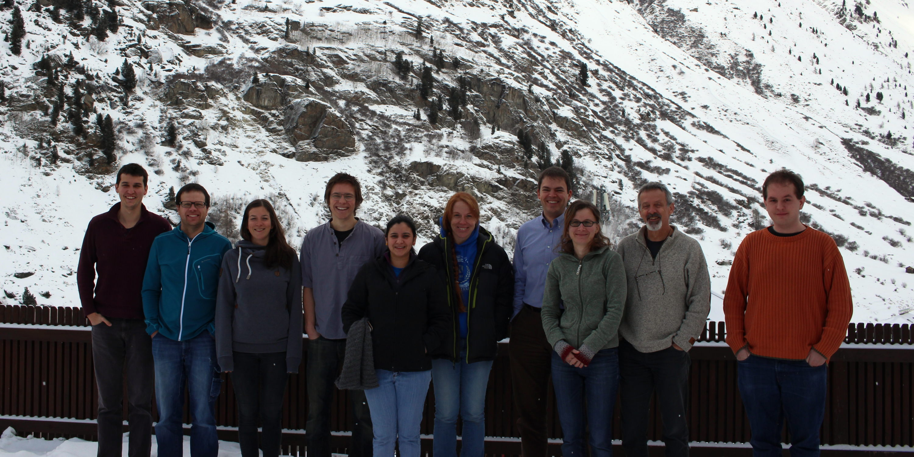
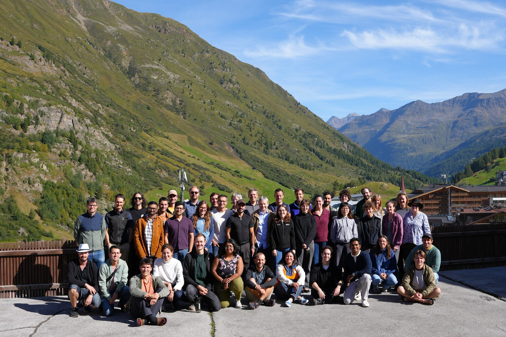
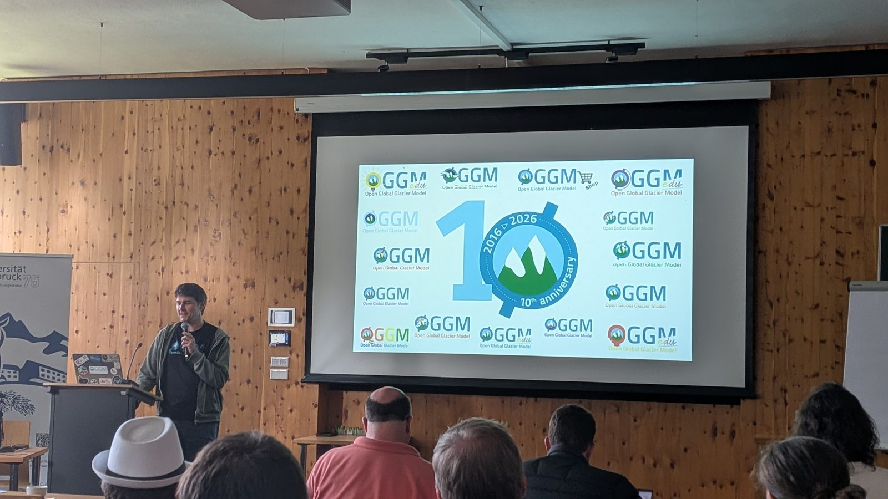
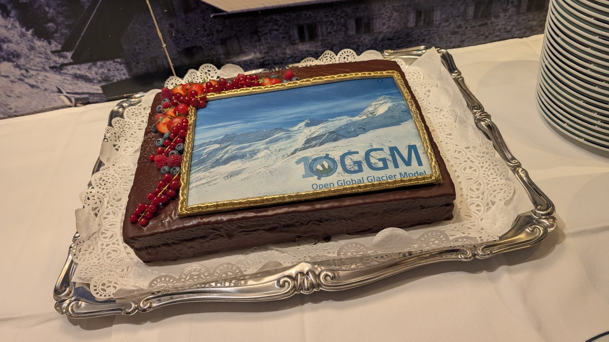
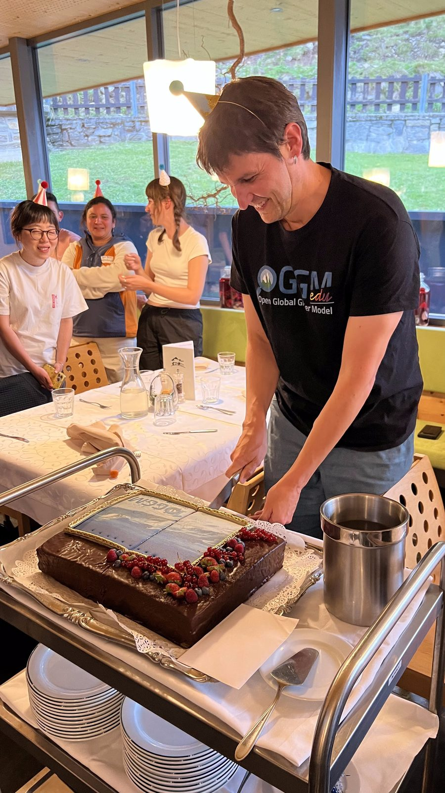

**Ten years ago, in February 2016, ten people met in Obergurgl, in the Austrian Alps, for the [first OGGM workshop](/2016/02/11/1st-oggm-worshop-summary/).** The code was only a few months old (the first lines were written in late 2015), and we spent a lot of time talking about avalanches and debris (neither of which made it into OGGM before much later!).

<figure>
    
    <figcaption><i>The first OGGM workshop, Obergurgl, February 2016.</i></figcaption>
</figure>

Ten years later, we went back to Obergurgl for the [Global Glacier Modelling Workshop](/2025/12/08/10th-workshop-announcement/) with quite a few more people and many friends from other models. We still talked about avalanches and debris, but also about plenty of other things.

<figure>
    
    <figcaption><i>The Global Glacier Modelling Workshop, Obergurgl, August 2026.</i></figcaption>
</figure>

This also led to perhaps the nerdiest birthday party you can think of!

<figure>
  

    

      
      
    

    

      
    

  

  <figcaption><i>Celebrating 10 years of OGGM in Obergurgl, August 2026.</i></figcaption>
</figure>

### Thank you!

We would like to take this opportunity to thank everyone in the wonderful OGGM community - it's been a great ride, made possible by everyone's contributions, small or big. On to the next 10 years!
